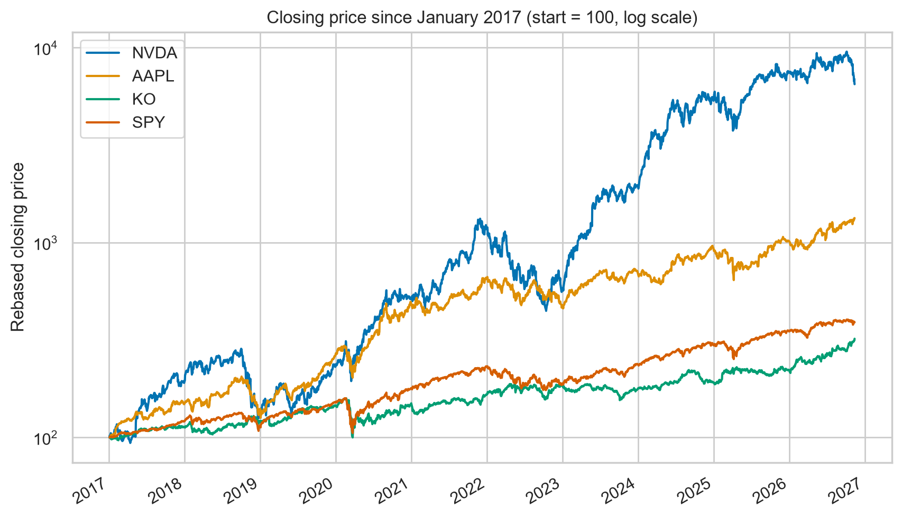
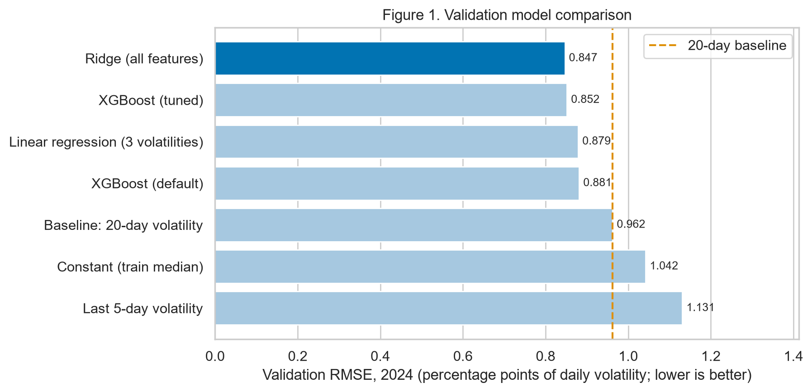
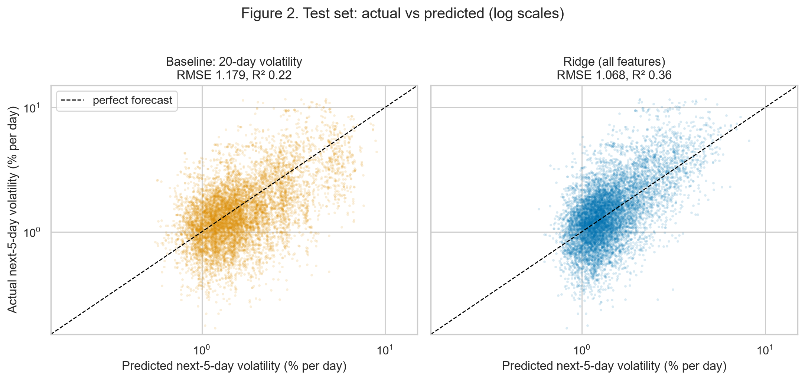
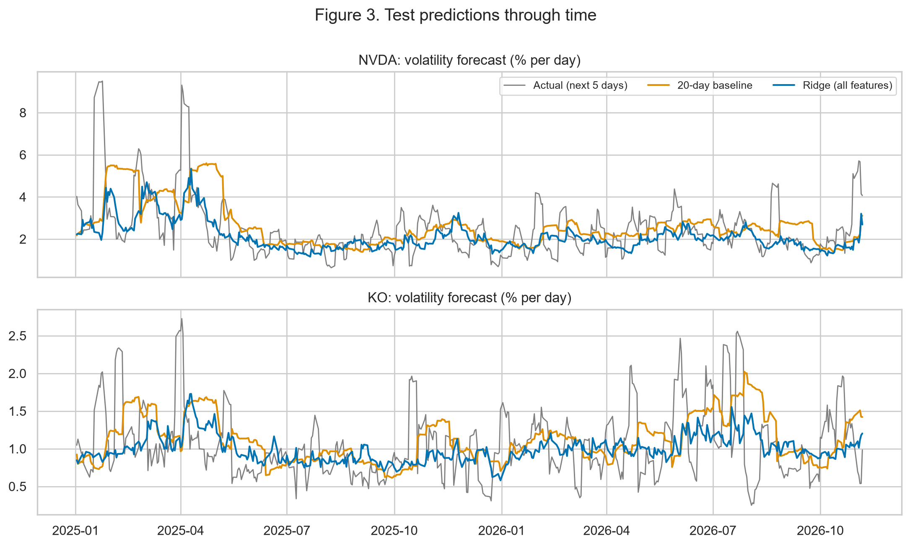
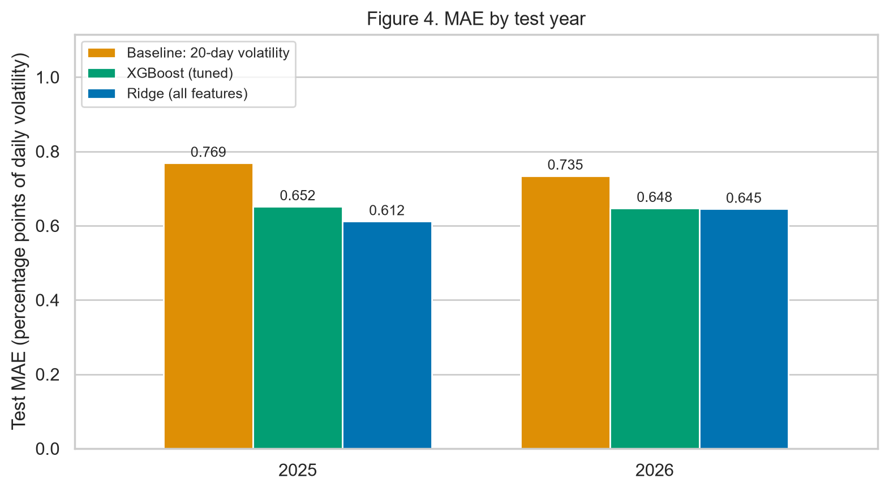
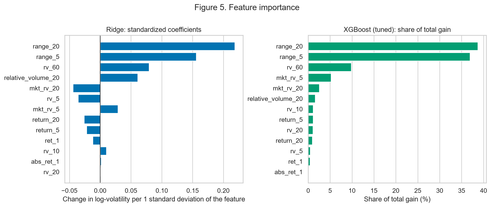

# Forecasting Short-Term Stock Market Volatility

Kaggle Project Benchmark: Report. CSCI 470 Machine Learning, Fall 2026, Colorado School of Mines.

Mark Suchodolskyi, November 15, 2026

**Research question:** Can machine learning predict the volatility of a stock over its next five trading days using historical price movements, trading volume, and market trends?

The full report is in [Report.pdf](Report.pdf) and the code is in [stock-market-volatility-predictor.ipynb](stock-market-volatility-predictor.ipynb).

## 1. Motivation and Practical Application

Financial market can experience many changes even in a single day. Some period of relative stability and others of substantial price fluctuations. That's why it is important to understand what will happen to the market.

An important characteristic of market timeline is **volatility clustering:** large price movement tend to happen with other large movements, while calmer periods tend to persist.

This application can assist investors and risk analysts by estimating stock's expected daily volatility over the next five trading days. For example, an analyst could compare the predicted volatility of different stock's and identify which one may require additional risk monitoring.

I chose this project to gain a better understanding of financial markets and of how well machine learning can predict these always-fluctuating markets.

## 2. Introduction

I plan to build a regression model that analyzes stock price history and predicts the magnitude of future price fluctuations.

I will focus on three things:

- **Prediction:** Estimate future volatility using data available at a fixed point in time.

- **Comparison:** Compare such ML algorithm with simple historical models.

  **Note:** Such comparison is not trivial, see [Forecasting realized volatility: Does anything beat linear models?](https://www.sciencedirect.com/science/article/abs/pii/S0927539824000598) [2]

- **Evaluation:** Measure how accurately models predict volatility on unseen data.

### 2.1 Target Interpretation

In the future section we will do feature engineering to process data. With that data we will estimate at the end of trading day $t$ how large the stock's daily price changes will be, on average, measured as the root mean square (RMS) of daily log returns, during trading days $t+1$ to $t+5$.

Define the closing price on trading day $t$ as $C(t)$.

#### Daily Logarithm Return

$$
r(t) = \ln\left(\frac{C(t)}{C(t-1)}\right)
$$

I am using logarithmic return because

- Log returns add over time, so $r(t) + r(t + 1)$ is the log return over two days.
- For typical daily price changes they are close to simple percentage returns ($\ln(x + 1) \approx x$)

#### Five Session Realized Volatility

$$
y(t) = \sqrt{ \frac{r(t+1)^2 + r(t+2)^2 + r(t+3)^2 + r(t+4)^2 + r(t+5)^2}{5} }
$$

#### Worked Example *(Illustrative, Not Market Data)*

Suppose a stock records the following daily log returns ($r_t$) over the next 5 trading sessions:

| Future Session ($t$) | 1 | 2 | 3 | 4 | 5 |
| :--- | :---: | :---: | :---: | :---: | :---: |
| **Daily Log Return ($r_t$)** | $+2\%$ | $-1\%$ | $+3\%$ | $-2\%$ | $+1\%$ |
| **Squared Return ($r_t^2$)** | $4$ | $1$ | $9$ | $4$ | $1$ |

We compute the target $y$ (5-day Root Mean Square daily volatility) as:

$$
y = \sqrt{\frac{1}{5} \sum_{t=1}^{5} r_t^2} = \sqrt{\frac{2^2 + (-1)^2 + 3^2 + (-2)^2 + 1^2}{5}} = \sqrt{\frac{19}{5}} = \sqrt{3.8} \approx 1.95\% \text{ daily RMS volatility}
$$

### 2.2 Success Criterion

The selected ML model has **lower held-out test RMSE** than the past 20-session RMS-volatility baseline.

## 3. Data Collection

The model uses historical data from Stooq for 20 large-cap US stocks across many industries, such as technology, financials, healthcare, etc. (for more details look below), together with SPY for more market conditions (look for definition below).

**Dataset:** [Stooq Historical Data](https://stooq.com/db/h/) [1].

**Download data for usage:** U.S. → Daily → ASCII

#### Expected bulk ASCII columns

```text
<TICKER>,<PER>,<DATE>,<TIME>,<OPEN>,<HIGH>,<LOW>,<CLOSE>,<VOL>,<OPENINT>
AAPL.US,D,20261113,000000,357.96,360.83,355.75,356.27,40027467,0
```

#### Quick Term Guide

- **Stock vs. ETF** — A **stock** is a share of ownership in one company. An **ETF** (Exchange-Traded Fund) holds a basket of securities and trades like a single stock; `SPY` holds the S&P 500, so its price tracks the broader US market.
- **`SPY` (SPDR S&P 500 ETF Trust)** — An exchange-traded fund tracking the S&P 500 (`us-daily-data/nyse etfs/2/spy.us.txt`), used as a proxy feature to capture broad, market-wide volatility that individual stock histories miss.

## 4. Data Cleaning

As seen from above downloaded data set is vast, so we will first make some data cleaning. We will keep the following stocks:

| Sector | Tickers | Count |
| :--- | :--- | :---: |
| **Technology** | `AAPL`, `MSFT`, `NVDA`, `AMD`, `INTC` | 5 |
| **Financials** | `JPM`, `BAC`, `V`, `MA` | 4 |
| **Consumer** | `WMT`, `COST`, `KO`, `PG` | 4 |
| **Healthcare** | `JNJ`, `PFE` | 2 |
| **Energy / Industry** | `XOM`, `CVX`, `CAT` | 3 |
| **Media / Entertainment** | `DIS`, `NFLX` | 2 |

### 4.1 Data We Are Working With

Loaded 52,101 rows for 21 tickers, 2017-01-03 to 2026-11-13. Example input rows (most recent five trading days of AAPL):

| ticker | date | open | high | low | close | volume |
| :--- | :--- | ---: | ---: | ---: | ---: | ---: |
| AAPL | 2026-11-09 | 344.733 | 352.063 | 344.518 | 350.424 | 48,790,090 |
| AAPL | 2026-11-10 | 351.083 | 353.601 | 346.197 | 348.245 | 29,778,670 |
| AAPL | 2026-11-11 | 349.280 | 355.640 | 349.060 | 355.360 | 34,479,650 |
| AAPL | 2026-11-12 | 357.810 | 359.368 | 354.410 | 354.880 | 31,874,980 |
| AAPL | 2026-11-13 | 357.960 | 360.830 | 355.750 | 356.270 | 40,027,470 |



*Figure 1: Closing price since January 2017 for four contrasting tickers (start = 100, log scale).*

## 5. Feature Engineering

We will design features for a better data interpretation. The model might benefit from knowing:

- How much has the stock changed recently?
- Has the stock become more volatile than usual?
- Are daily trading ranges increasing?
- What happens to trading activity?

| Feature | Mathematical Definition | Motivation |
| :--- | :--- | :--- |
| **`ret_1`** | $r(t) = \ln\left(\frac{C(t)}{C(t-1)}\right)$ | Most recent signed shock |
| **`abs_ret_1`** | $\lvert r(t) \rvert$ | Most recent shock size |
| **`return_5`** | $\ln\left(\frac{C(t)}{C(t-5)}\right)$ | Recent momentum / short-term trend |
| **`return_20`** | $\ln\left(\frac{C(t)}{C(t-20)}\right)$ | Medium-term momentum / trend |
| **`rv_5`** | $\sqrt{\frac{1}{5}\sum_{i=0}^{4} r(t-i)^2}$ | Short-term volatility persistence (5-day) |
| **`rv_10`** | $\sqrt{\frac{1}{10}\sum_{i=0}^{9} r(t-i)^2}$ | Short-term volatility persistence (10-day) |
| **`rv_20`** | $\sqrt{\frac{1}{20}\sum_{i=0}^{19} r(t-i)^2}$ | Medium-term volatility (20-day) |
| **`rv_60`** | $\sqrt{\frac{1}{60}\sum_{i=0}^{59} r(t-i)^2}$ | Longer-term volatility baseline (60-day) |
| **`range_5`** | $\frac{1}{5}\sum_{i=0}^{4} \frac{H(t-i) - L(t-i)}{C(t-i)}$ | Intraday trading range (5-day) |
| **`range_20`** | $\frac{1}{20}\sum_{i=0}^{19} \frac{H(t-i) - L(t-i)}{C(t-i)}$ | Intraday trading range (20-day) |
| **`relative_volume_20`** | $\frac{V(t)}{\frac{1}{20}\sum_{i=0}^{19} V(t-i)}$ | Unusual trading activity |
| **`mkt_rv_5`** | `rv_5` computed on SPY | Short-term market-wide volatility |
| **`mkt_rv_20`** | `rv_20` computed on SPY | Medium-term market-wide volatility |

**Notation.** For a given stock on trading day $t$: $C(t)$ is the closing price, $H(t)$ the highest price of the day, $L(t)$ the lowest price of the day, and $V(t)$ the number of shares traded (volume). $r(t)$ is the daily log return (`ret_1`). Every feature uses data up to and including day $t$ only. The two market features apply the same volatility formulas to SPY, giving 13 features in total.

After feature engineering: 44,500 stock-day rows, 13 features, 20 stocks (5,120 warm-up / no-target rows dropped). Dates: 2018-01-02 to 2026-11-06.

## 6. Leakage-Safe Experimental Design

To make sure that model never sees tests that it will be tested on, I will separate whole data into 3 parts: Train, Validation, and Test data. Each separation is done on time, so:

| Split | Forecast Dates ($t$) | Inclusion / Leakage Rule |
| :--- | :--- | :--- |
| **Training** | `2018-01-01` to `2023-12-31` | Include a row only if its 5th future trading day ($t+5$) is $\le$ `2023-12-31`. |
| **Validation** | `2024-01-01` to `2024-12-31` | Include a row only if its 5th future trading day ($t+5$) is $\le$ `2024-12-31`. |
| **Final Test** | `2025-01-01` to latest fully labeled `2026` date | Strict holdout: never used to choose features, hyperparameters, or the winning model. |

#### Why do we remove rows at the boundaries?

Because then model will use outcomes from the other split in the current one. E.g., training data will use some part of validation data, which would leak the data and show incorrect training results.

| Set | First day | Last day | Rows | Share (%) | Mean target (%) |
| :--- | :--- | :--- | ---: | ---: | ---: |
| Train | 2018-01-02 | 2023-12-21 | 30,080 | 67.6 | 1.693 |
| Validation | 2024-01-02 | 2024-12-23 | 4,940 | 11.1 | 1.398 |
| Test | 2025-01-02 | 2026-11-06 | 9,280 | 20.9 | 1.735 |

Purged rows (target window crosses a boundary): 200.

## 7. Models and Training

Now, let's consider different models to use.

| Experiment | Configuration | Reason to Include |
| :--- | :--- | :--- |
| **A. Constant median** | Median training target *(no fitting)* | Sanity check: difficulty relative to trivial guessing |
| **B. Last 5-day volatility** | `Prediction = rv_5` *(no fitting)* | Short-memory persistence |
| **C. 20-day RMS baseline** | `Prediction = rv_20` *(no fitting)* | Direct benchmark: volatility persistence |
| **D. Linear regression** | `LinearRegression` on log `rv_5`, `rv_20`, `rv_60` | Classic three-horizon volatility model |
| **E. Ridge regression** | `StandardScaler` + `Ridge(alpha=10)` on all 13 features | Interpretable regularized linear regression |
| **F. XGBoost (default)** | `XGBRegressor` with library defaults | Captures nonlinearities, untuned |
| **G. XGBoost (tuned)** | 12-configuration grid, early stopping on validation | Tests whether tuning and capacity help |

XGBoost tuning, best five of 12 configurations:

| max_depth | learning_rate | min_child_weight | rounds | val MAE | val RMSE |
| ---: | ---: | ---: | ---: | ---: | ---: |
| 2 | 0.05 | 20 | 601 | 0.4965 | 0.8517 |
| 3 | 0.05 | 20 | 119 | 0.4950 | 0.8521 |
| 5 | 0.05 | 100 | 65 | 0.4949 | 0.8523 |
| 3 | 0.05 | 100 | 196 | 0.4963 | 0.8525 |
| 5 | 0.02 | 20 | 163 | 0.4946 | 0.8526 |

## 8. Evaluation and Results Analysis

For each model from above we will consider MAE (lower is better), RMSE (lower is better) and $\text{R}^2$ (higher is better) errors. As well as show relative improvement from the baseline.

$$
\text{Improvement}(\%) = 100 \times (1 - \text{RMSE}(\text{model}) / \text{RMSE}(\text{baseline}))
$$

| Model | Test MAE | Test RMSE | Test R² | Improvement (%) |
| :--- | ---: | ---: | ---: | ---: |
| Ridge (all features) | 0.627 | 1.068 | 0.36 | 9.4 |
| XGBoost (tuned) | 0.650 | 1.111 | 0.31 | 5.7 |
| Linear regression (3 volatilities) | 0.649 | 1.112 | 0.30 | 5.7 |
| Baseline: 20-day volatility | 0.753 | 1.179 | 0.22 | 0.0 |
| XGBoost (default) | 0.701 | 1.210 | 0.18 | −2.6 |
| Last 5-day volatility | 0.828 | 1.316 | 0.03 | −11.6 |
| Constant (train median) | 0.790 | 1.400 | −0.10 | −18.7 |

### 8.1 Visualize Results

Let's answer the next questions:

- What model performed best in 2024?
- Are predictions accurate across low/high volatility?
- How well model responds to change in market conditions?
- Is performance stable in 2025 vs 2026?
- Which engineered featured were the most useful?



*Figure 2: Validation model comparison.*



*Figure 3: Test set: actual vs predicted.*



*Figure 4: Test predictions through time.*



*Figure 5: MAE by test year.*



*Figure 6: Feature importance.*

### 8.2 Model Performance Results

We found out that machine learning can improve short-term volatility predictions compared with baseline estimator.

Ridge Regression achieved the lowest validation RMSE of 0.847 and was selected as the final model. On the held-out test dataset, Ridge achieved an RMSE of 1.068 percentage points, compared with 1.179 for the 20-day historical-volatility baseline. It gives a 9.4% reduction in RMSE.

Ridge also achieved a lower MAE of 0.627 compared with the baseline's 0.753, representing an improvement of approximately 16.7%. Its test R² was 0.359, compared with 0.218 for the baseline.

Interestingly, increasing model complexity did not necessarily improve performance. The default XGBoost model produced a test RMSE of 1.210, which was worse than the simple historical baseline.

Hyperparameter tuning improved XGBoost's test RMSE to 1.111, but the tuned model still performed worse than Ridge Regression.

The most useful features were `range_5` and `range_20` affecting the volatility the most.

Finally, Ridge outperformed the baseline in both test years when evaluated using MAE. Meaning that the overall improvement was not restricted to a single year.

## 9. Challenges

1. The main challenge is unpredictable market events. Historical data cannot predict unexpected news, geopolitical developments or just sudden changes in investor behavior.

2. Changes in market timeline. The validation and test periods had different volatility characteristics. Ridge's RMSE increased from 0.847 in validation to 1.068 in testing, which means that performance in one year may not fully represent general performance.

3. Dataset limitations. I only used 20 selected large-cap stocks, but they do not represent the entire stock market. Selecting them can introduce survivorship bias (focusing on winners).

4. Uncertainty. Models produced point predictions rather than prediction intervals. Volatility does not give the full associated uncertainty in the market.

### Ethical Implications

Although volatility forecasts can help investors assess financial risk, inaccurate predictions may create a false sense of security. In particular, relying too heavily on volatility forecasts could lead users to take greater financial risks.

Therefore, all predictions made by the model should be considered estimates rather than guarantees.

## 10. Conclusion

The main objective of this project was to determine if the machine learning can predict future stock volatility better than a simple baseline model.

The objective was achieved. Ridge Regression reduced held-out test RMSE by 9.4% compared with the 20-day historical-volatility baseline.

However, the model was less reliable when anticipating sudden volatility spikes. Its predictions were more effective at estimating general volatility conditions, disregarding extreme events discussed in challenges.

Though this project, I learned the importance of feature engineering, chronological data splitting, prevention of data leakage, comparing models against meaningful baseline, and creating separate split of validation and testing data.

If I had to do this project again, I would experiment with more hyperparameters for Ridge Regression and XGBoost, hoping for further improvement. I would also consider different training and validation splits.

As a next step, I would consider additional features to improve predictions during sudden volatility spikes, which Ridge Regression struggles with.

## 11. Acknowledgment and References

### Acknowledgments

- **Data.** Daily price and volume history was obtained from the Stooq historical database [1], which is free for non-commercial use.
- **AI assistance.** I used Claude (Anthropic) through Claude Code to help debug parts of the code, to verify results by re-running the pipeline independently, and to review the notebook for errors. ChatGPT (OpenAI) was used at the start to help search for ideas and scope the specific project. All results were produced by running the code in this notebook on the Stooq data, and I reviewed the analysis and conclusions.
- **Software.** The models were built with scikit-learn [4] and XGBoost [5], using pandas, NumPy, Matplotlib and seaborn for data handling and figures.

### References

1. Stooq. *Historical data: U.S. daily (ASCII)*. https://stooq.com/db/h/ (downloaded November 2026).
2. Branco, R. R., Rubesam, A., and Zevallos, M. (2024). Forecasting realized volatility: Does anything beat linear models? *Journal of Empirical Finance*, 78, 101524. https://www.sciencedirect.com/science/article/abs/pii/S0927539824000598. Motivation for comparing machine learning against simple linear models.
3. Corsi, F. (2009). A simple approximate long-memory model of realized volatility. *Journal of Financial Econometrics*, 7(2), 174-196. Source of the idea of regressing volatility on short-, medium- and long-horizon past volatility (the three-volatility linear regression).
4. Pedregosa, F., et al. (2011). Scikit-learn: Machine learning in Python. *Journal of Machine Learning Research*, 12, 2825-2830.
5. Chen, T., and Guestrin, C. (2016). XGBoost: A scalable tree boosting system. *Proceedings of the 22nd ACM SIGKDD Conference*, 785-794.
